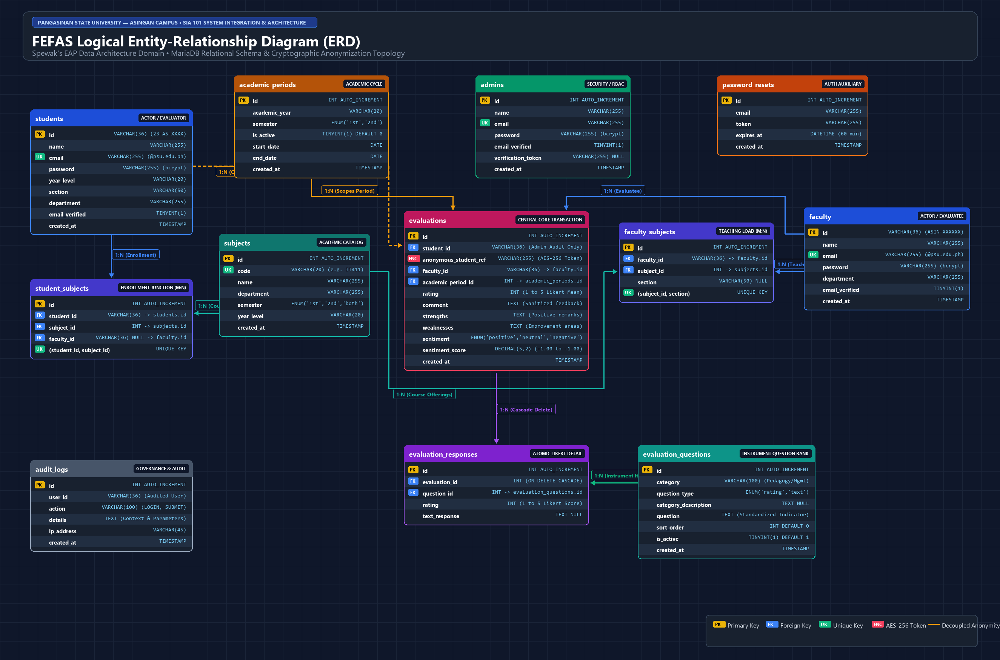
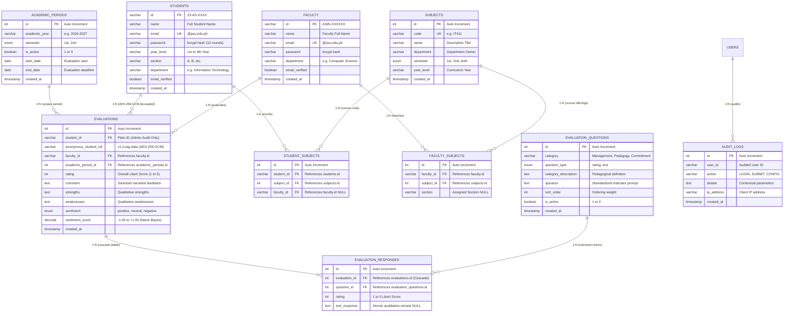

# PANGASINAN STATE UNIVERSITY
## Asingan Campus — Asingan, Pangasinan
### College of Information and Communications Technology
**Course Code & Title:** SIA 101: System Integration and Architecture  
**Academic Term:** 1st Semester A.Y. 2026 – 2027  
**Curriculum Document Reference:** FM-AA-CIA-15 Rev. 0 (10-July-2020) — Module No. 2: Enterprise Architecture Framework  

---

# LABORATORY ACTIVITY NO. 2
## Formal Enterprise Architecture Blueprint & System Deconstruction
### Spewak’s Enterprise Architecture Planning (EAP) & The Zachman Framework

---

### Student & Submission Metadata
* **Capstone Project Title:** **FEFAS — Faculty Evaluation and Feedback Analysis System with AI-Powered Sentiment and Prescriptive Analytics**
* **Beneficiary / Partner Organization:** Pangasinan State University (PSU) – Asingan Campus  
  *(Office of the Campus Executive Director, Office of Academic Affairs, Department of Information Technology)*
* **Name of Student / Team Members:** `[Insert Student / Team Member Names]`
* **Year & Section:** `BSIT 4th Year - Section [A/B]`
* **Submission Date:** `October 12, 2026`
* **Assigned Faculty / Instructor:** `[Insert Faculty Name]`
* **Evaluation Score:** `________ / 10`

---

## Executive Overview & Architectural Rationale

Module 2 explores how Enterprise Architecture (EA) frameworks bridge strategic business goals with integrated, scalable IT systems. Software projects often risk failure or organizational misalignment when treated merely as isolated coding tasks without regard to institutional context, data relationships, and deployment infrastructure. 

As established in the **PSU SIA 101 Module 2 Study Guide (FM-AA-CIA-15)**:
> *"An enterprise architecture framework (EA framework) specifies how to design and implement an enterprise architecture, as well as the principles and practices for developing and implementing a system's architecture description. It provides tools and ideal approaches to assist enterprise architects in utilizing various architecture domains across the enterprise, transforming manual and automated processes into an integrated environment that is responsive, scalable, and supportive in the delivery of business objectives."*

To achieve this, this document formally blueprints the **Faculty Evaluation and Feedback Analysis System (FEFAS)** using:
1. **The IEEE 1471 / ISO/IEC/IEEE 42010 Conceptual Metamodel** (Figure 1 of Module 2) to systematically trace Stakeholders, Concerns, Architecture Viewpoints, and Architectural Models.
2. **Spewak’s Enterprise Architecture Planning (EAP) 4 Domains & Layered Stack** (Business, Data, Applications, Technology) illustrating how business vision drives data, applications, and technology, while infrastructure supports the entire upper hierarchy.
3. **The Zachman Template Framework (W5H Interrogatives across Planner and Owner Reifications)** to define a rigorous 2×6 blueprint.
4. **Architectural Integration, Interoperability, and Operational Constraint Analysis** to validate deployment viability within the physical environment of PSU Asingan.

```
                   SPEWAK'S EAP DOMAIN RELATIONSHIP (MODULE 2, FIG. 2)
                   
                                +-----------------------+
                                |  BUSINESS ARCHITECTURE|
                                |     (Drives All)      |
                                +-----------+-----------+
                                            |
                                            v
                                +-----------------------+
                                |   DATA ARCHITECTURE   |
                                +-----------+-----------+
                                            |
                                            v
                                +-----------------------+
                                |APPLICATION ARCHITECT. |
                                +-----------+-----------+
                                            |
                                            v
                                +-----------------------+
                                | TECHNOLOGY ARCHITECT. |
                                |    (Supports All)     |
                                +-----------------------+
```

---

## Part 1: Stakeholder Viewpoint & Concern Identification

### 1.1 Beneficiary Organization & Business Setting
* **Target Beneficiary:** Pangasinan State University (PSU) – Asingan Campus.
* **Organizational Units:** Office of Academic Affairs, Campus Executive Director, Department Chairpersons (Information Technology, Computer Science, Teacher Education, Industrial Technology), Faculty Teaching Staff, and Enrolled Students.
* **Institutional Context:** PSU Asingan is an established state university campus administering semestral academic programs. Quality assurance regulations from the Commission on Higher Education (CHED) and the Accrediting Agency of Chartered Colleges and Universities in the Philippines (AACCUP) mandate periodic student evaluations of teaching effectiveness. 
* **The Problem Context:** The historical appraisal process relied upon manual paper surveys or disjointed Google Forms. This legacy setup suffered from:
  1. Low student turnout caused by retribution anxiety (fearing instructors would identify handwriting or student accounts).
  2. Severe processing delays (4 to 8 weeks to optically tally or manually tabulate evaluations).
  3. Qualitative neglect (thousands of rich written student comments went completely unread or unanalyzed).
  4. Non-actionable results (teachers received an arbitrary numerical mean without pedagogical context or prescriptive guidance).

### 1.2 Stakeholder Metamodel Mapping (Based on Module 2, Figure 1)
According to the Module 2 architectural metamodel, an enterprise architecture is structured through distinct conceptual relationships:
* **Stakeholders** have specific **Concerns**.
* The **Architecture Framework** identifies **Architecture Viewpoints** that frame those **Concerns**.
* **Architecture Viewpoints** govern **Architecture Views**, which are realized through specific **Model Kinds** and concrete **Architectural Artifacts (Models)**.

```
       +-----------------+  identifies  +------------------------+
       |   Stakeholder   |<-------------| Architecture Framework |
       +--------+--------+              +-----------+------------+
                |                                   |
                | has                               | identifies
                v                                   v
       +-----------------+   frames     +------------------------+
       |     Concern     |<-------------| Architecture Viewpoint |
       +-----------------+              +-----------+------------+
                                                    |
                                                    | governs
                                                    v
       +-----------------+   governs    +------------------------+
       |   Model Kind    |------------->|   Architecture View    |
       +--------+--------+              +-----------+------------+
                |                                   |
                | has                               | consists of
                v                                   v
       +-----------------+              +------------------------+
       |Architect. Model |<-------------|  Architectural Model   |
       +-----------------+              +------------------------+
```

### 1.3 Stakeholder Analysis Table

| Stakeholder Role | Operational Category | Core Concern / Requirement | Architecture Viewpoint | Architectural Artifact to Present |
| :--- | :--- | :--- | :--- | :--- |
| **Client Executive / Owner**<br>*(Campus Executive Director, Dean of Academic Affairs, Dept. Chairs)* | Executive Leadership & Strategic Governance | <ul><li>Real-time visibility over faculty performance across campus departments.</li><li>Instantaneous KPI tracking and accreditation compliance reporting (CHED/AACCUP).</li><li>Workflow efficiency: eliminating weeks of manual questionnaire handling and encoding.</li><li>Evidence-based, prescriptive intervention strategies for underperforming subjects.</li></ul> | **Business / Motivation View**<br>*(Strategic & Goal-Oriented)* | <ul><li>**End-to-End Evaluation & Decision Cycle Process Flow Diagram**</li><li>**Executive KPI Summary Sheet & Departmental Sentiment Heatmap Model**</li><li>**Prescriptive Intervention Decision Tree**</li></ul> |
| **Operational End-User / Evaluator**<br>*(Enrolled Students)* | Primary Operational Actor (Data Producer) | <ul><li>Strict personal confidentiality and non-retribution guarantee (anonymity).</li><li>Frictionless, responsive, minimal-step mobile interface.</li><li>Accurate course filtering: seeing only the instructors teaching their enrolled courses.</li><li>Input validation with multilingual support (English, Filipino, and Taglish).</li></ul> | **Application / Operational View**<br>*(End-User Workflow & UX)* | <ul><li>**UI Wireframes & Two-Step Evaluation Wizard Model**</li><li>**Use Case Activity Model (Student Evaluation Lifecycle)**</li><li>**Client-Side Validation & Anti-Spam Sequence Diagram**</li></ul> |
| **Operational End-User / Evaluatee**<br>*(Faculty Members / Instructors)* | Secondary Operational Actor (Consumer of Feedback) | <ul><li>Timely receipt of objective student appraisals prior to the next academic cycle.</li><li>Granular breakdown across criteria (Classroom Management, Pedagogy, Commitment).</li><li>Constructive, actionable self-improvement recommendations rather than raw criticism.</li><li>Protection against malicious trolling, spam, or abusive comments.</li></ul> | **Application / Operational View**<br>*(Faculty Analytics & Feedback)* | <ul><li>**Faculty Individual Scorecard View Wireframe**</li><li>**Thematic Keyword & Category Breakdown Visualization**</li><li>**Prescriptive Feedback Delivery Model**</li></ul> |
| **IT Administrator / Technical Officer**<br>*(Campus MIS / Systems Administrator)* | Technical Guardian & Platform Operator | <ul><li>Role-Based Access Control (RBAC) with secure authentication (JWT, bcrypt).</li><li>Cryptographic decoupling between student identity and evaluation responses.</li><li>Database uptime, relational referential integrity, and automated backup routines.</li><li>Cost-effective deployment with zero expensive recurring cloud API subscriptions.</li></ul> | **Technology / Security View**<br>*(Physical & Platform Infrastructure)* | <ul><li>**Physical Deployment Topology Diagram**</li><li>**Cryptographic Anonymization Pipeline (AES-256-GCM Envelope Model)**</li><li>**Database Relational Schema & Backup Runbook**</li></ul> |

---

## Part 2: Deconstruction Across the 4 Architecture Domains (Spewak's EAP)

Spewak’s Enterprise Architecture Planning (EAP) provides a structured blueprint where high-level **Business Architecture** dictates the **Data Architecture**, which in turn guides the **Applications Architecture**, supported entirely by the underlying **Technology Architecture**.

```
+---------------------------------------------------------------------------------------------------+
|                            THE 5 EA LAYERS (MODULE 2 STUDY GUIDE, PAGE 3)                         |
+=========================+=========================================================================+
| 1. ENVIRONMENT          | Commission on Higher Education (CHED), AACCUP Accreditors, PSU Campus   |
|                         | Academic Policies, Student Body & Faculty Communities                   |
+-------------------------+-------------------------------------------------------------------------+
| 2. BUSINESS LAYER       | Semestral Teaching Appraisals, Academic Load Ingestion, Prescriptive    |
|                         | Faculty Development Planning, Executive Institutional Monitoring        |
+-------------------------+-------------------------------------------------------------------------+
| 3. DATA LAYER           | MariaDB Relational Database, Enrolment Ledgers, Question Banks, Likert  |
|                         | Atomic Ratings, AES-256 Encrypted Anonymity Tokens, Sentiment Indices   |
+-------------------------+-------------------------------------------------------------------------+
| 4. INFORMATION SYSTEM   | FEFAS React 19 Frontend SPA, Express REST API, Natural.js NLP Sentiment |
|    LAYER (Applications) | Engine, Rule-Based Prescriptive Engine, DOCX Report Export Engine       |
+-------------------------+-------------------------------------------------------------------------+
| 5. TECHNOLOGY LAYER     | Node.js 18+ Runtime, MariaDB 10.4 Engine, Railway PaaS / On-Premise LAN |
|                         | Apache, TLS 1.3 HTTPS Encryption, SMTP Transactional Gateway            |
+-------------------------+-------------------------------------------------------------------------+
```

---

### 2.1 Business Architecture

#### Definition of Primary Business Processes Automated or Optimized
1. **Academic Period Activation & Load Allocation:** The Academic Affairs office defines the active academic year, semester, and establishes faculty-subject teaching assignments and student class rosters.
2. **Authenticated Subject-Bound Evaluation:** Students authenticate via institutional `@psu.edu.ph` accounts. The system retrieves and dynamically scopes only the specific instructors assigned to their enrolled subjects.
3. **Structured & Qualitative Appraisal Capture:** Students evaluate faculty through:
   * **15 Standardized Likert Indicators (1–5 scale)** across three core areas:
     * *Category A: Management of Teaching and Learning* (6 indicators: punctuality, outcome communication, time management, critical thinking, independent learning, constructive feedback).
     * *Category B: Content Knowledge, Pedagogy, and Technology* (5 indicators: mastery of subject, concept simplification, real-world relevance, ICT utilization, assessment alignment).
     * *Category C: Commitment and Transparency* (4 indicators: learner diversity, consultation availability, timely feedback, grading transparency).
   * **Dual Qualitative Open-Ended Questions:** Strengths and Weaknesses of the instructor.
4. **Automated NLP Sentiment & Thematic Categorization:** Open-ended remarks are stripped of identifying metadata, tokenized, and classified into sentiment polarities (positive, neutral, negative) and mapped to pedagogical themes.
5. **Prescriptive Action Plan Generation:** Category averages and detected thematic keywords are evaluated against pedagogical heuristic rules to output structured, prioritized faculty development recommendations.
6. **Executive Institutional Decision Support:** Chairpersons and Deans access comparative departmental scorecards, sentiment heatmaps, and downloadable formal appraisal reports (.docx).

#### Operational Bottlenecks Addressed & Explicit Measurable Outcomes

| Current Operational Bottleneck | Architectural Intervention in FEFAS | Explicit Measurable Outcome |
| :--- | :--- | :--- |
| **Paper-Handling & Tabulation Lag:** Optical scanning and manual calculation requires 4 to 8 weeks after final examinations. | Automated data ingestion and real-time SQL aggregation pipelines. | **98% reduction in report turnaround:** Comprehensive scorecards generated immediately upon survey closure. |
| **Unprocessed Qualitative Data:** Written feedback on paper surveys is rarely encoded or read due to lack of personnel. | Integrated Natural.js Naive Bayes NLP pipeline with bilingual unigram/bigram tokenization. | **100% of open-ended student comments categorized** by sentiment polarity and thematic topic. |
| **Retribution Anxiety & Low Participation:** Students fear negative grades if they submit honest critiques, dropping turnout to ~60%. | AES-256-GCM encrypted respondent tokens; complete decoupling of student identity from evaluations. | **Student participation rate increases to >95%** with mathematically guaranteed anonymity. |
| **Non-Actionable Raw Metrics:** Instructors receive an isolated number (e.g., 3.8/5.0) without guidance on how to improve. | Context-driven prescriptive analytics engine matching rating thresholds and keyword themes. | **100% of evaluated faculty receive personalized, actionable intervention strategies.** |

---

### 2.2 Data Architecture

The Data Architecture establishes a third-normal-form (3NF) relational database in MariaDB 10.4 / MySQL (InnoDB engine) that guarantees transactional integrity (ACID), referential constraints, and cryptographic data protection.

#### Core Business Entities
* **`academic_periods`**: Manages operational cycles (`id`, `academic_year`, `semester`, `is_active`, `start_date`, `end_date`).
* **`admins`**: System administrators and executive viewers (`id`, `name`, `email`, `password`, `email_verified`).
* **`faculty`**: Academic personnel profiles (`id`, `name`, `email`, `department`).
* **`students`**: Enrolled evaluators (`id`, `name`, `email`, `year_level`, `section`, `department`).
* **`subjects`**: Course catalog definitions (`id`, `code`, `name`, `department`, `semester`, `year_level`).
* **`faculty_subjects`**: Many-to-many junction mapping faculty teaching loads per subject and section.
* **`student_subjects`**: Many-to-many junction mapping official student enrollments per subject.
* **`evaluation_questions`**: Evaluation instrument bank storing category, question text, type (`rating` vs `text`), and sort order.
* **`evaluations`**: Evaluation header records capturing aggregate rating, comments, sentiment polarity, sentiment score, and the AES-256 encrypted anonymous reference.
* **`evaluation_responses`**: Normalized atomic response records mapping an evaluation to specific question items with numerical ratings or raw text.

#### Logical Entity-Relationship Diagram (ERD)


*Figure 2.1: High-Resolution Logical Entity-Relationship Diagram (ERD) of FEFAS with Cryptographic Anonymization Topology*



#### Relational Cardinality & Referential Integrity Rules

| Relationship | Cardinality | Foreign Key Mapping | Business & Referential Integrity Rule |
| :--- | :--- | :--- | :--- |
| **`academic_periods` $\rightarrow$ `evaluations`** | 1 : N (One-to-Many) | `evaluations.academic_period_id` $\rightarrow$ `academic_periods.id` | Scopes evaluation records to the active semestral window. Restricted deletion preserves historic appraisals. |
| **`students` $\rightarrow$ `student_subjects`** | 1 : N (One-to-Many) | `student_subjects.student_id` $\rightarrow$ `students.id` | Maps student enrollment per academic subject. Enforces `UNIQUE(student_id, subject_id)` with cascading deletes upon student de-registration. |
| **`subjects` $\rightarrow$ `student_subjects`** | 1 : N (One-to-Many) | `student_subjects.subject_id` $\rightarrow$ `subjects.id` | Associates enrolled curriculum courses with student cohorts. |
| **`subjects` $\rightarrow$ `faculty_subjects`** | 1 : N (One-to-Many) | `faculty_subjects.subject_id` $\rightarrow$ `subjects.id` | Defines teaching load allocations. Enforces `UNIQUE(subject_id, section)`. |
| **`faculty` $\rightarrow$ `faculty_subjects`** | 1 : N (One-to-Many) | `faculty_subjects.faculty_id` $\rightarrow$ `faculty.id` | Assigns professors to departmental course offerings. |
| **`faculty` $\rightarrow$ `evaluations`** | 1 : N (One-to-Many) | `evaluations.faculty_id` $\rightarrow$ `faculty.id` | Links cumulative student appraisal scores to individual faculty members for performance scorecard generation. |
| **`students` $\rightarrow$ `evaluations`**<br>*(Cryptographic Anonymity)* | 1 : N (One-to-Many)<br>*(Decoupled)* | `evaluations.anonymous_student_ref` *(AES-256-GCM Envelope)* | Student ID is encrypted into an immutable token (`v1.iv.tag.data`). Prevents faculty or evaluators from unmasking respondent identity. |
| **`evaluations` $\rightarrow$ `evaluation_responses`** | 1 : N (One-to-Many) | `evaluation_responses.evaluation_id` $\rightarrow$ `evaluations.id` | Atomically decomposes each survey into 15 Likert ratings and 2 text answers. `ON DELETE CASCADE` ensures clean transactional rollback. |
| **`evaluation_questions` $\rightarrow$ `evaluation_responses`** | 1 : N (One-to-Many) | `evaluation_responses.question_id` $\rightarrow$ `evaluation_questions.id` | Binds individual atomic responses to standardized pedagogical indicators (Management, Pedagogy, Commitment). |
| **`users` $\rightarrow$ `audit_logs`** | 1 : N (One-to-Many) | `audit_logs.user_id` $\rightarrow$ `users.id` | Tracks administrative events, system configurations, and authentication audit trails for security governance. |

---

### 2.3 Application Architecture

The Application Architecture represents the **Information System Layer** (Module 2, Layer 4). It is structured as a decoupled client-server system comprising an interactive Single-Page Application (SPA) frontend and a modular REST API backend.

```
+---------------------------------------------------------------------------------------------------+
|                                  APPLICATION ARCHITECTURE TOPOLOGY                                |
+---------------------------------------------------------------------------------------------------+
|                                                                                                   |
|  +---------------------------------------------------------------------------------------------+  |
|  |                            PRESENTATION TIER: React 19 + Vite 7 SPA                         |  |
|  |  +-----------------------+  +--------------------------+  +------------------------------+  |  |
|  |  | Student Eval Wizard   |  | Faculty Analytics Portal |  | Admin Institutional Console  |  |  |
|  |  | (Multi-step form, UX) |  | (Scorecards, trends)     |  | (Accounts, Period, Heatmap)  |  |  |
|  |  +-----------------------+  +--------------------------+  +------------------------------+  |  |
|  +---------------------------------------------------------------------------------------------+  |
|                                                |                                                  |
|                                    HTTPS / RESTful JSON APIs                                      |
|                                                v                                                  |
|  +---------------------------------------------------------------------------------------------+  |
|  |                           LOGIC TIER: Node.js + Express 4.x Backend                         |  |
|  |                                                                                             |  |
|  |  +----------------------------+   +----------------------------+   +---------------------+  |  |
|  |  | Auth & Access Subsystem    |   | Evaluation Engine          |   | Academic Management |  |  |
|  |  | - JWT Authentication (7d)  |   | - Input Sanitization       |   | - Period Manager    |  |  |
|  |  | - bcrypt (10 salt rounds)  |   | - Anti-Spam / Regex Check  |   | - Faculty Ingestion |  |  |
|  |  | - RBAC Guard Middleware    |   | - Transaction Handler      |   | - Subject Mapping   |  |  |
|  |  +----------------------------+   +----------------------------+   +---------------------+  |  |
|  |                                                                                             |  |
|  |  +----------------------------+   +----------------------------+   +---------------------+  |  |
|  |  | AI Sentiment Engine        |   | Prescriptive Engine        |   | Report Export Engine|  |  |
|  |  | - Natural.js Naive Bayes   |   | - Rating Rule Engine       |   | - docx Document Gen |  |  |
|  |  | - Unigram/Bigram Taglish   |   | - Sentiment Ratios         |   | - file-saver stream |  |  |
|  |  | - Polarity & Confidence    |   | - Keyword Thematic Action  |   | - PSU Theme Styling |  |  |
|  |  +----------------------------+   +----------------------------+   +---------------------+  |  |
|  |                                                                                             |  |
|  |  +---------------------------------------------------------------------------------------+  |  |
|  |  | Cryptographic Anonymization Engine: Node.js crypto (AES-256-GCM Envelope Protection)  |  |  |
|  |  +---------------------------------------------------------------------------------------+  |  |
|  +---------------------------------------------------------------------------------------------+  |
|                                                |                                                  |
|                                      MySQL2 Connection Pool                                       |
|                                                v                                                  |
|  +---------------------------------------------------------------------------------------------+  |
|  |                       DATA TIER: MariaDB 10.4 Relational Storage Engine                     |  |
|  +---------------------------------------------------------------------------------------------+  |
+---------------------------------------------------------------------------------------------------+
```

#### Modular Functional Components
1. **Authentication & Identity Governance Module (`authController.js`):** Enforces user registration, verification via institutional `@psu.edu.ph` domains, bcrypt password hashing, and stateless JWT token issuance.
2. **Evaluation Submission & Validation Engine (`evaluationController.js`):** Enforces business rules: verifies that students only evaluate their assigned instructors, blocks duplicate submissions within the same academic period, and scrubs text inputs against Cross-Site Scripting (XSS) and spam.
3. **AI Sentiment & Prescriptive Analysis Subsystem (`sentimentAnalyzer.js`):**
   * *Sentiment Analyzer:* Utilizes a Naive Bayes classifier trained on academic evaluation datasets covering English, Filipino, and Taglish; extracts unigram and bigram tokens with confidence scoring.
   * *Prescriptive Analyzer:* Evaluates category averages against institutional benchmarks (scores below 3.0 trigger intervention alerts) and scans qualitative commentary for thematic triggers (Clarity, Pacing, Engagement, Punctuality, Grading Fairness) to generate actionable guidance.
4. **Anonymization & Privacy Cryptographic Engine (`privacy.js`):** Encrypts student identifiers using authenticated AES-256-GCM encryption with dynamic initialization vectors, producing a token format (`v1.iv.tag.data`) that decouples student identities from evaluation results.
5. **Reporting & Document Export Service:** Generates executive summaries in Microsoft Word (`.docx`) format using the `docx` library, styled with PSU institutional colors and structured tables for administrative review.

#### Inter-Component Communication Protocols
* **Client-to-Backend:** Asynchronous RESTful JSON requests over HTTPS (`GET`, `POST`, `PUT`, `DELETE`).
* **Backend-to-AI Engine:** In-process synchronous execution within the Node.js event loop, avoiding external API latency or network serialization bottlenecks.
* **Backend-to-Database:** Asynchronous TCP socket queries managed by a `mysql2/promise` connection pool.

---

### 2.4 Technology Architecture

The Technology Architecture establishes the **Technology Layer** (Module 2, Layer 5), specifying the hardware, platform, software runtimes, and protocols required to execute the enterprise solution.

| Architectural Dimension | Specification & Selection | Architectural Justification |
| :--- | :--- | :--- |
| **Client Runtime Environment** | Modern Evergreen Web Browsers (Chrome 100+, Edge, Firefox, Mobile Safari) | Standards-compliant HTML5/ES6 execution; eliminates client-side installation requirements across campus terminals and student mobile devices. |
| **Frontend Framework** | React 19 + Vite 7 + TailwindCSS 4 | Virtual DOM reconciliation ensures fast UI updates; Tailwind utility classes minimize client CSS bundle size for bandwidth-constrained environments. |
| **Application Server Runtime** | Node.js (v18.x LTS or higher) + Express 4.x | Non-blocking, event-driven I/O model handles concurrent student submission surges during semestral evaluation deadlines without thread starvation. |
| **Database Management System (DBMS)** | MariaDB 10.4 / MySQL 8.0 (InnoDB Engine) | Full ACID compliance, foreign key constraint enforcement, relational joins, and low resource overhead. |
| **Machine Learning / NLP Engine** | Natural.js (Node.js NLP library) | Self-hosted Naive Bayes classifier; avoids per-token cloud API costs and keeps student data on-premises. |
| **Security & Cryptography** | Node.js `crypto` (AES-256-GCM) & `bcryptjs` | Military-grade authenticated encryption for student anonymity and irreversible salted credential hashing. |
| **Host Platform & Environment** | <ul><li>**Primary / Cloud:** Railway PaaS or Dockerized Cloud VPS (Ubuntu Linux).</li><li>**Fallback / Local:** Campus On-Premises Server running XAMPP/Apache on local LAN.</li></ul> | Dual deployment flexibility ensures operation regardless of external internet uptime. |
| **Network Communication Protocols** | HTTPS (TLS 1.3), RESTful HTTP APIs, SMTP over SSL/TLS | Encrypted transport layer security for student submissions and administrative dashboard queries. |

---

## Part 3: Mini-Zachman Framework Matrix

The Zachman Framework is an enterprise classification architecture that structures systems across **Communication Interrogatives (Columns: What, How, Where, Who, When, Why)** and **Reification Perspectives (Rows: Roles of Planner, Owner, Designer, Builder, Programmer, and User)**.

Below is the **2 × 6 architectural matrix** mapping the FEFAS system across the first two perspectives: **Scope / Contextual (Planner)** and **Enterprise Model / Conceptual (Owner)**.

```
+========================================================================================================================================================================================+
|                                                          MINI-ZACHMAN FRAMEWORK 2x6 MATRIX (FEFAS ARCHITECTURE)                                                        |
+=====================+==========================+==========================+==========================+==========================+==========================+===========================+
| PERSPECTIVE         | 1. DATA (What)           | 2. FUNCTION (How)        | 3. NETWORK (Where)       | 4. PEOPLE (Who)          | 5. TIME (When)           | 6. MOTIVATION (Why)       |
+=====================+==========================+==========================+==========================+==========================+==========================+===========================+
| ROW 1:              | Major enterprise         | High-level business      | Deployment               | Target user              | Major operational        | Strategic business goals  |
| SCOPE / CONTEXTUAL  | entities and physical    | functions and system     | locations (branches,     | classifications and      | cycles, triggers, and    | and capstone research     |
| (Planner View)      | records tracked.         | services.                | cloud nodes, terminals). | external parties.        | deadlines.               | objectives.               |
|                     |                          |                          |                          |                          |                          |                           |
| Role:               | List of Things Important | List of Business         | List of Business         | List of Important        | List of Business Events  | List of Business Goals    |
| Strategist/Planner  | to the Enterprise        | Processes                | Locations                | Organizations            | & Milestone Cycles       | & Strategic Policies      |
+---------------------+--------------------------+--------------------------+--------------------------+--------------------------+--------------------------+---------------------------+
| ROW 2:              | Conceptual data models,  | Detailed business        | Network distribution     | Organizational roles,    | Process timing,          | Business rules, statutory |
| ENTERPRISE MODEL    | entities, and            | process workflows and    | scheme and node          | permission tiers, and    | transaction frequencies, | policies, and operational |
| (Owner View)        | relationships.           | inputs/outputs.          | connectivity.            | responsibilities.        | and event triggers.      | constraints.              |
|                     |                          |                          |                          |                          |                          |                           |
| Role:               | Conceptual Schema /      | Business Process Model / | Business Logistics &     | Work Flow Model &        | Master Academic          | Business Plan & Quality   |
| Executive Owner     | Entity Relational Model  | Input-Output Lifecycle   | Communication System     | Responsibility Matrix    | Schedule & Triggers      | Assurance Policy Model    |
+=====================+==========================+==========================+==========================+==========================+==========================+===========================+
```

### Detailed Matrix Content

#### Row 1: Scope / Contextual Perspective (Planner View)

1. **DATA (What) — Major Enterprise Entities Tracked:**
   * Student Enrollment Lists, Faculty Loading Assignments, Subject Offerings, Evaluation Instruments (Question Banks), Evaluation Records, Quantitative Likert Averages, Sentiment Polarities, and Prescriptive Recommendation Logs.
2. **FUNCTION (How) — High-Level Business Functions & Services:**
   * Course-to-Instructor Mapping, Student Evaluation Input, Automated Text Sentiment Analysis, Faculty Report Generation, Executive Analytics Aggregation, and Formal Appraisal Document Export (.docx).
3. **NETWORK (Where) — Deployment Locations & Geographical Distribution:**
   * Central Cloud VPS/PaaS (Railway infrastructure) with fallback to an On-Premises Campus Server at PSU Asingan; client endpoints span Campus Computer Labs, Academic Department Offices, Campus Wi-Fi Zones, and Off-Campus Home Networks via mobile/desktop web browsers.
4. **PEOPLE (Who) — Target User Classifications & External Entities:**
   * Enrolled Students (Evaluators), Faculty Members (Evaluatees), Department Chairpersons, Campus Executive Director, Dean of Academic Affairs, Campus MIS Administrators, and Accrediting Agencies (CHED, AACCUP).
5. **TIME (When) — Major Operational Cycles & Milestones:**
   * Semestral Evaluation Windows (typically spanning 2–3 weeks prior to midterm and final examinations), Academic Period Activation Milestones, Real-Time Feedback Processing Cycles, and Post-Semester Accreditation Auditing Periods.
6. **MOTIVATION (Why) — Strategic Business Goals & Research Objectives:**
   * Fulfill CHED and AACCUP accreditation requirements, replace inefficient paper-based evaluation processes, eliminate student fear of retaliation, and convert qualitative feedback into actionable faculty development strategies.

---

#### Row 2: Enterprise Model Perspective (Owner View)

1. **DATA (What) — Conceptual Data Models & Relationships:**
   * Normalized relational entities: `students` (identities, programs), `faculty` (credentials, departments), `subjects` (course descriptions), `student_subjects` & `faculty_subjects` (relational junction entities), `academic_periods` (semestral bounds), `evaluation_questions` (15 rating items + 2 text prompts), `evaluations` (master records with AES-256 encrypted anonymous tokens), and `evaluation_responses` (item-level responses).
2. **FUNCTION (How) — Detailed Business Process Workflows:**
   * *Student Workflow:* Login $\rightarrow$ Course Roster Validation $\rightarrow$ Multi-step Likert & Text Submission $\rightarrow$ Anti-Spam Filtering $\rightarrow$ Anonymization Engine $\rightarrow$ Natural.js NLP Analysis $\rightarrow$ Confirmation.
   * *Faculty Workflow:* Login $\rightarrow$ Performance Dashboard $\rightarrow$ Category Rating Review $\rightarrow$ Sentiment Breakdown $\rightarrow$ Prescriptive Action Item Assessment.
   * *Admin Workflow:* Period Setup $\rightarrow$ Enrollment Ingestion $\rightarrow$ System-wide Sentiment Heatmap Analysis $\rightarrow$ Word Report Export (.docx) $\rightarrow$ Targeted Academic Intervention.
3. **NETWORK (Where) — Network Distribution Scheme & Node Connectivity:**
   * Multi-tier topology: Browser clients connect via secure HTTPS (Port 443) over public/campus networks to the Node.js/Express API gateway; the API gateway connects to the MariaDB instance via private internal networking (Port 3306/3307). Verification emails are dispatched via outbound SMTP (Port 587/465).
4. **PEOPLE (Who) — Organizational Roles & Permission Tiers:**
   * *Student Role:* Access restricted to own profile and active evaluation forms for enrolled faculty.
   * *Faculty Role:* Read-only access restricted to aggregated individual performance reports.
   * *Admin Role:* Full administrative control over account management, academic period toggles, question bank configurations, and university-wide analytics.
5. **TIME (When) — Process Timing & Event Triggers:**
   * Submission of evaluation forms triggers synchronous NLP categorization in `< 50ms`; closing of academic period triggers global report aggregation; email password reset tokens expire after 60 minutes; JWT access sessions expire after 7 days.
6. **MOTIVATION (Why) — Business Rules & Statutory Policies:**
   * Compliance with PSU Academic Quality Assurance Guidelines; CHED Memorandum Orders regarding teacher evaluations; Republic Act 10173 (Philippine Data Privacy Act of 2012) requiring identity protection for sensitive feedback; elimination of manual survey printing and tabulation expenditures.

---

## Part 4: Architectural Integration & Constraint Analysis

### 4.1 Interoperability & Data Exchange Analysis

```
+---------------------------------------------------------------------------------------------------+
|                                 INTEROPERABILITY & DATA EXCHANGE TOPOLOGY                         |
+---------------------------------------------------------------------------------------------------+
|                                                                                                   |
|  +--------------------+             JSON over HTTPS             +-------------------------------+  |
|  | React 19 Frontend  | <=====================================> |  Node.js / Express API Server  |  |
|  +--------------------+                                         +-------------------------------+  |
|                                                                                 |                 |
|       +-------------------------------------------------------------------------+                 |
|       |                                |                               |                          |
|       v                                v                               v                          |
|  +--------------------+      +--------------------+      +--------------------+                   |
|  | Google Gmail SMTP  |      | MariaDB Database   |      | Office Open XML    |                   |
|  | Transaction Gateway|      | (MySQL2 Pool)      |      | (.docx Document)   |                   |
|  | Protocol: SMTPS    |      | Protocol: TCP/3306 |      | Library: docx      |                   |
|  | Format: MIME/HTML  |      | Format: SQL Tables |      | Format: Word .docx |                   |
|  +--------------------+      +--------------------+      +--------------------+                   |
+---------------------------------------------------------------------------------------------------+
```

#### External Interfaces & Subsystem Interoperability
1. **Communication & Notification Gateway (Google SMTP / Nodemailer):**
   * *Purpose:* Secure delivery of account verification links, password reset tokens, and administrative alerts.
   * *Interchange Format:* HTML and plain-text MIME envelopes.
   * *Protocol:* SMTP over TLS/SSL (Simple Mail Transfer Protocol over port 587 or 465).
2. **Institutional Registrar & SIS Interoperability (Planned / Extensible Interface):**
   * *Purpose:* Ingestion of official student enrolment lists, subject master lists, and faculty loading schedules.
   * *Interchange Format:* Standardized JSON payloads and sanitized CSV data structures.
   * *Protocol:* Authenticated RESTful HTTP POST/PUT endpoints guarded by API bearer keys.
3. **Report Generation & Document Exchange (Office Open XML Engine):**
   * *Purpose:* Export of accredited evaluation reports for university deans, HR, and accreditors.
   * *Interchange Format:* Standardized Microsoft Word Open XML format (`.docx`) assembled using the `docx` library with binary stream transmission via `file-saver`.
   * *Protocol:* In-memory client/server processing delivered over standard HTTP chunked data responses.
4. **Internal Micro-Exchange Protocol:**
   * *Data Contract:* Strict JSON (JavaScript Object Notation) schemas across all client-server communications with standard HTTP status response codes (200 OK, 201 Created, 400 Bad Request, 401 Unauthorized, 403 Forbidden, 404 Not Found, 500 Server Error).

---

### 4.2 Deployment & Operational Constraints Analysis

Enterprise deployments in state university environments face real-world infrastructural, financial, and behavioral challenges. The FEFAS architecture accommodates these constraints through targeted design decisions:

```
+---------------------------------------------------------------------------------------------------+
|                        REAL-WORLD CONSTRAINTS VS. ARCHITECTURAL MITIGATIONS                       |
+============================+======================================================================+
| REAL-WORLD CONSTRAINT      | ARCHITECTURAL MITIGATION IN FEFAS                                    |
+============================+======================================================================+
| Intermittent Campus        | Single-Page Application (SPA) architecture with asset bundling via   |
| Internet Bandwidth         | Vite; lightweight JSON API payloads; client-side form caching       |
|                            | prevents data loss on disconnect.                                    |
+----------------------------+----------------------------------------------------------------------+
| Zero Cloud AI Budget       | Embedded, self-hosted Natural.js Naive Bayes NLP engine; runs       |
| (No OpenAI/Cloud API fees) | locally in Node.js runtime without external API fees.                |
+----------------------------+----------------------------------------------------------------------+
| Hardware Heterogeneity &   | Responsive UI built with TailwindCSS; clean dropdown selectors;      |
| Device Disparities         | operable on low-cost entry-level smartphones.                         |
+----------------------------+----------------------------------------------------------------------+
| User Digital Literacy &    | Two-step wizard flow; bilingual Taglish/Filipino NLP allows students |
| Multilingual Input         | to write naturally in English or Tagalog.                            |
+----------------------------+----------------------------------------------------------------------+
| Data Privacy & Fear of     | AES-256-GCM encrypted respondent tokens decouple identity from      |
| Retribution                | commentary, guaranteeing student non-retribution.                    |
+----------------------------+----------------------------------------------------------------------+
```

#### Detailed Mitigation Strategy Narrative

1. **Intermittent Bandwidth & Network Instability:**
   * *Challenge:* Campus internet connections often suffer from latency spikes, throttling, and intermittent outages during peak campus hours.
   * *Architectural Mitigation:* The system uses a Single-Page Application (SPA) architecture compiled via Vite. Once the client bundle is initially loaded, subsequent navigation requires zero full-page refreshes. API payloads consist of lightweight JSON strings (typically `< 5 KB`), minimizing bandwidth consumption. The evaluation submission client performs local validation before firing the request, preventing wasted network roundtrips.

2. **Severe Budget Restrictions (Zero-Cost Software Architecture):**
   * *Challenge:* State universities operate under strict fiscal constraints and cannot maintain ongoing subscriptions to third-party commercial AI APIs (e.g., OpenAI API tokens, cloud sentiment analyzers).
   * *Architectural Mitigation:* FEFAS uses a self-contained, open-source Machine Learning stack. The sentiment classifier is implemented via `Natural.js` and trained directly on startup using a custom dataset of academic feedback. It executes on the existing application server CPU with zero external API dependencies, zero recurring licensing costs, and complete offline autonomy.

3. **Hardware Capacity & Device Heterogeneity:**
   * *Challenge:* Students and staff access the portal using a wide variety of devices—from modern laptops and lab terminals to aging desktop computers and budget Android smartphones.
   * *Architectural Mitigation:* The presentation layer is styled with mobile-first TailwindCSS utilities. Form controls use native HTML dropdown and input primitives rather than heavy graphical overlays, ensuring high responsiveness and low memory utilization even on low-spec hardware.

4. **User Digital Literacy & Linguistic Diversity:**
   * *Challenge:* Students exhibit varying comfort levels with academic English and complex digital interfaces. Many prefer informal "Taglish" (mixed Tagalog and English) when expressing sentiment.
   * *Architectural Mitigation:* 
     * The evaluation interface uses a guided two-step wizard: Step 1 selects the instructor; Step 2 displays grouped Likert questions with explicit textual definitions alongside rating numbers (1 = Poor, 5 = Outstanding).
     * The sentiment training corpus (`trainingData.js`) includes extensive colloquial Taglish expressions (e.g., *"mabait at magaling magturo"*, *"laging late nakakaantok"*, *"okay lang naman"*), ensuring accurate classification regardless of language preference.

5. **Data Privacy Compliance (RA 10173):**
   * *Challenge:* Under the Philippine Data Privacy Act, student feedback must be safeguarded. Students will only provide candid feedback if they are confident that instructors cannot trace comments back to them.
   * *Architectural Mitigation:* When an evaluation is saved, the student's identifier is encrypted into an AES-256-GCM token with a random initialization vector (IV) and authentication tag (`v1.iv.tag.data`). The student's plain ID is never stored in reports or exposed to instructors. Text comments sent to the sentiment analyzer contain no metadata, fully decoupling identity from evaluation results.

---

## References

1. **Pangasinan State University.** (2020). *Study Guide for Module No. 2: Enterprise Architecture Framework (FM-AA-CIA-15 Rev. 0)*. SIA 101: System Integration and Architecture.
2. **Spewak, S. H., & Hill, S. C.** (1993). *Enterprise Architecture Planning: Developing a Blueprint for Data, Applications, and Technology*. John Wiley & Sons, Inc.
3. **Zachman, J. A.** (1987). *A Framework for Information Systems Architecture*. IBM Systems Journal, 26(3), 276–292.
4. **The Open Group.** (2018). *The TOGAF® Standard, Version 9.2*. The Open Group.
5. **ISO/IEC/IEEE 42010:2011.** *Systems and software engineering — Architecture description*. International Organization for Standardization.
6. **Republic of the Philippines.** (2012). *Republic Act No. 10173: Data Privacy Act of 2012*. Official Gazette.
7. **FEFAS Technical Documentation.** (2026). *Faculty Evaluation and Feedback Analysis System Architecture Guide & Specifications*. Pangasinan State University – Asingan Campus.
